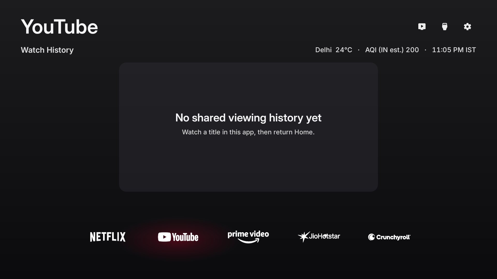
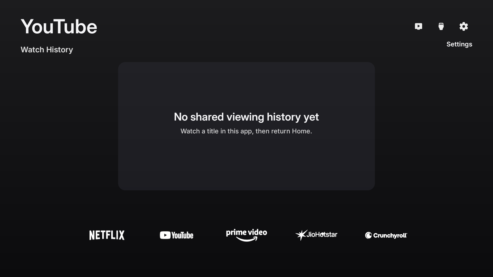
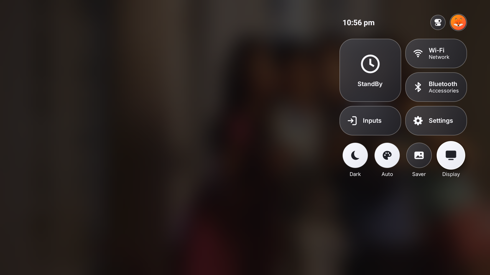
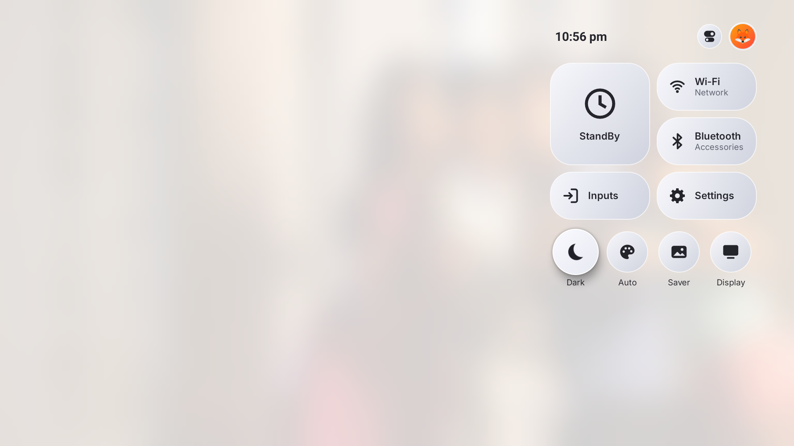
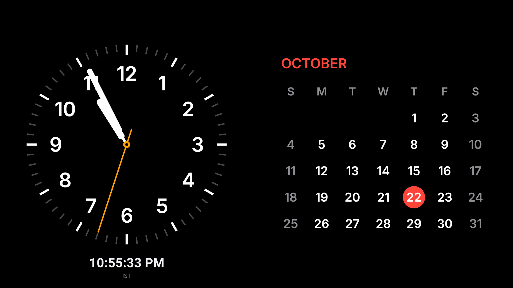

# OpenTVOS

A compact Android TV / Fire TV launcher with floating white app logos, a soft brand-colour focus glow, bare top-right controls and an app-specific watch-history carousel. Your TV's operating system still runs underneath it.

**[Download OpenTVOS 1.2.2](https://github.com/uphomesco-hub/opentvos/releases/tag/v1.2.2)** · **[Install it yourself — no AI agent needed](docs/INSTALLATION.md)** · [Build from source](hybrid/README.md) · [TV verification](hybrid/VERIFICATION.md)

## The main app

**This design is the maintained version on `main`.** Its source is in [hybrid/](hybrid/); the Android package is `io.freemytv` and the public app is labelled **OpenTVOS**. The older `Yash TV` / original `tvOS` experiments are separate apps and are not the current release APK.

- White logos float directly over the existing blurred artwork. There are no dock tiles or shared background strip.
- The focused logo grows by 20%, with a soft glow in its brand colour. The three top-right icons are bare and enlarge on focus.
- A centred Watch History carousel follows the selected dock app; its artwork drives the ambient background. Saved observations have no title-count or age cutoff, including completed titles.
- Compact tvOS-style Control Centre, profile avatars/photo picker, native settings shortcuts and remote navigation.
- Light, Dark and location-based sunrise/sunset Automatic appearance. The requested white dock-logo treatment is retained in both modes.
- Configurable weather and estimated Indian-scale AQI. Delhi / IST defaults; the clock time zone remains IST in this release.
- Manual StandBy with analog clock + digital time + calendar, plus four other layouts; the cinematic photo screensaver now uses saved watched-title artwork. If no suitable image exists it displays the same StandBy widgets.

**Core features need no OpenTVOS account or movie API key.** The release APK contains no personal TMDB/Watchmode credentials. Watch history and screensaver images use metadata/artwork shared on this device, including public Prime landscape artwork for observed titles. No full streaming-account history is imported; empty apps show an explanatory placeholder.

## Screenshots

Actual captures from the current public APK on a Fire TV. Personal watch history, account details and network names are excluded.

## Install on another TV

1. Check **Android TV / Google TV with Android 9+**, or a compatible Android-based Fire TV. This APK does not run on Samsung Tizen, LG webOS, Apple tvOS or Vega OS.
2. Download **`OpenTVOS-v1.2.2.apk`** from [release Assets](https://github.com/uphomesco-hub/opentvos/releases/tag/v1.2.2).
3. Transfer it to the TV, allow installation for your file manager/download app, and open the APK to install it. A computer/ADB alternative is documented too.
4. Open **OpenTVOS** from Apps, then configure Home separately: use Android's Home chooser or a compatible Fire TV helper.
5. Enable notification access for shared Continue Watching, then choose your favourites, appearance and location with the remote.

**[Follow the complete installation steps, commands and troubleshooting guide](docs/INSTALLATION.md).** No source build or AI agent is required. Home-button rules vary by firmware; keep the factory launcher installed.

Updates require the same signing identity as the existing `io.freemytv` installation. A different Free My TV build can cause a signature conflict; uninstalling it deletes app data. See the guide before changing an existing setup.

## Source and releases

- [hybrid/app/](hybrid/app/): current Android Java/resources.
- [hybrid/build_public.py](hybrid/build_public.py): builds the public APK in isolation with blank catalogue keys and a manifest-derived versioned filename.
- [hybrid/README.md](hybrid/README.md): developer build, private configuration and regression checks.
- [hybrid/VERIFICATION.md](hybrid/VERIFICATION.md): tested device, checks and limits.
- [Earlier reverse-engineered tvOS experiment](docs/LEGACY-TVOS.md): preserved root `src/`, `base/`, `reference/` and older build tools. Build the current app from **hybrid**, not the repository-root `build.py`.

Release APKs and checksums are attached to GitHub Releases. Signing keys, personal configuration, API credentials and private device evidence are excluded from Git. Upstream Free My TV's [MIT license](hybrid/LICENSE) and [third-party provenance](docs/PROVENANCE.md) are preserved.
